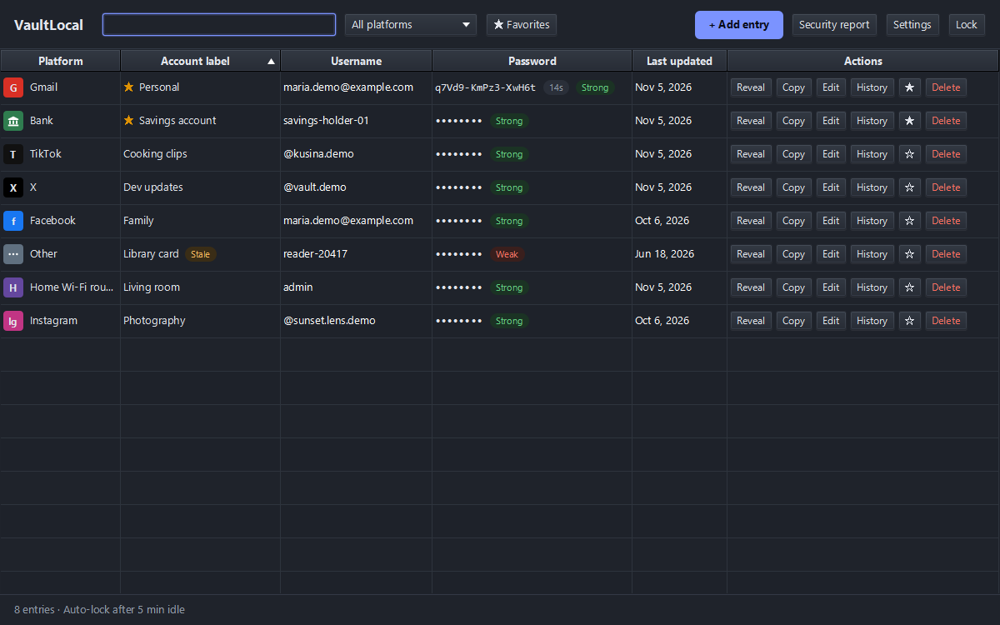
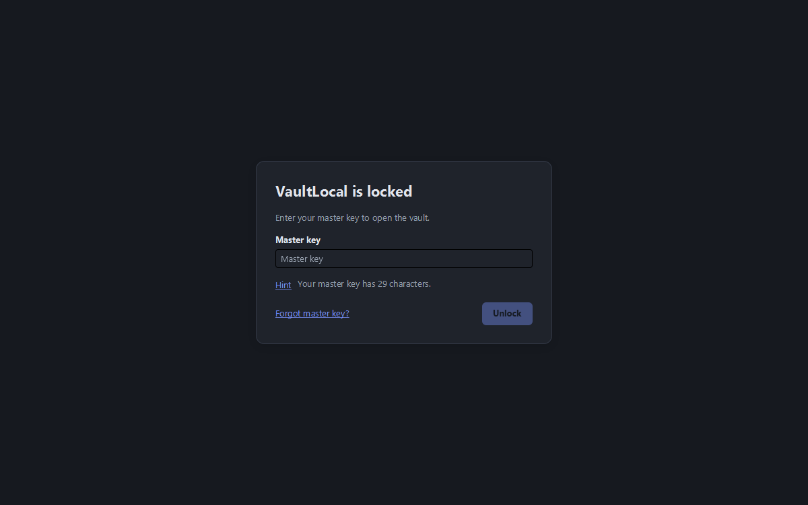
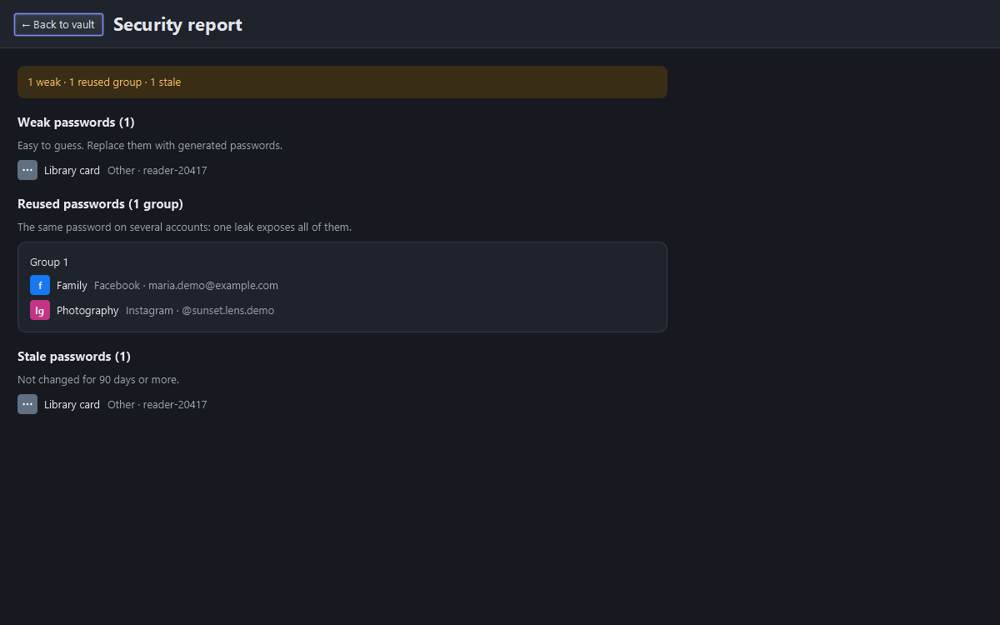

# VaultLocal

[](https://github.com/dev-codewitheli/vaultlocal/actions/workflows/ci.yml)

**An offline, local-only desktop password manager.** There are no accounts, no cloud, no sync,
no telemetry and no update checks. VaultLocal contains no network code at all, and the build
enforces that.



## Highlights

- **Envelope encryption:**
  - A random 256-bit data key encrypts every field you enter with AES-256-GCM (fresh nonce per
    field). Each ciphertext is bound to its row, field and key generation.
  - That data key is wrapped twice: by a key derived from your **master key** (Argon2id,
    128 MiB, t=3) and by one derived from your **security answers** (Argon2id, 256 MiB, t=6).
  - No password hash is stored anywhere. A wrong key simply fails to decrypt.
- **Secrets as `char[]`/`byte[]`, zeroed after use.** A custom `SecretField` input control
  replaces JavaFX's `PasswordField`, which makes `String` copies of what you type.
- **Shoulder-surfing resistant:**
  - Passwords are always shown as a fixed-width mask, and every reveal or copy asks for the
    master key.
  - A revealed password hides again after 15 s, or as soon as the window loses focus.
  - The Hint shows only the key's length.
- **Progressive lockout** (1 s, 2 s, 4 s … up to 60 s), persisted, so restarting the app
  doesn't skip it.
- **Recovery** with three security questions **rotates the data key**, so copies of the old
  key wraps become useless.
- **Extras:**
  - password generator, strength meter
  - clipboard copy that auto-clears and stays out of Windows Clipboard History
  - auto-lock (idle, sleep, Win+L)
  - search, favorites, stale-password badge, security report (weak / reused / stale)
  - password history, encrypted `.vlbackup` backups, local activity log, light/dark theme

## Built with

Java 21 · JavaFX 21 · Gradle (Kotlin DSL) · SQLite (xerial sqlite-jdbc) · Bouncy Castle
(Argon2id) · JCA AES-256-GCM · JNA · JUnit 5 · AssertJ · TestFX (headless Monocle) · ArchUnit ·
jlink/jpackage + WiX

The code follows a hexagonal (ports and adapters) layout. ArchUnit tests enforce the boundaries:

```
domain/                      pure Java: secrets, entries, policies (no dependencies)
application/                 use cases + ports; encryption happens here, so storage never sees plaintext
adapters/crypto/             Argon2id (Bouncy Castle), AES-GCM (JCA), SecureRandom
adapters/persistence-sqlite/ JDBC repositories + migrations (encrypted blobs only)
adapters/ui-javafx/          screens, SecretField, auto-lock, clipboard, Windows session hook
app/                         composition root, logging, strength estimator, packaging
```

## Security, verified

Each item in [`docs/SECURITY_CHECKLIST.md`](docs/SECURITY_CHECKLIST.md) comes with evidence:
- 0 network connections and 0 socket events, both for a full scripted run and for the packaged app
- no plaintext in the database (checked with the `sqlite3` CLI plus a raw-byte canary scan)
- no secrets in logs or crash output
- key material zeroed in place
- lockout surviving a process restart
- recovery leaving no trace of the old key wrap

The threat model, including what VaultLocal **doesn't** protect against (such as malware on an
unlocked machine), and why security questions are weaker than the master key, is in
[`docs/DESIGN.md`](docs/DESIGN.md).

<p>
  
  
</p>

## Download (Windows)

Get `VaultLocal-x.y.z.msi` from [Releases](https://github.com/dev-codewitheli/vaultlocal/releases/latest).
It installs per-user and needs no admin rights. The installer isn't code-signed, so Windows
SmartScreen may ask you to confirm. See the [user guide](docs/USER_GUIDE.md) for setup,
recovery and backups.

## Build from source

Requires JDK 21.

```bash
./gradlew test                      # 109 tests, including headless UI tests
./gradlew :app:run                  # run from source (vault in %LOCALAPPDATA%\VaultLocal)
./gradlew :app:run -Pvaultlocal.home=build/dev-vault   # throwaway dev vault
./gradlew :app:appImage             # self-contained app folder (jlink runtime, no installer)
./gradlew :app:msi -Pwix.dir=C:\path\to\wix314         # Windows installer (WiX Toolset 3.x)
```

**macOS and Linux:** the code is cross-platform, but `jpackage` builds installers only for the
OS it runs on. Run `:app:appImage` on that OS, then
`jpackage --type dmg|pkg|deb|rpm --app-image app/build/jpackage/image/VaultLocal`. macOS also
needs a Developer ID for signing and notarization; Linux needs `fakeroot` for `.deb` or
`rpm-build` for `.rpm`.

## Docs

- [DESIGN.md](docs/DESIGN.md): architecture, schema, key hierarchy, threat model, decisions
- [SECURITY_CHECKLIST.md](docs/SECURITY_CHECKLIST.md): verification and evidence
- [USER_GUIDE.md](docs/USER_GUIDE.md): setup, everyday use, recovery, backups
