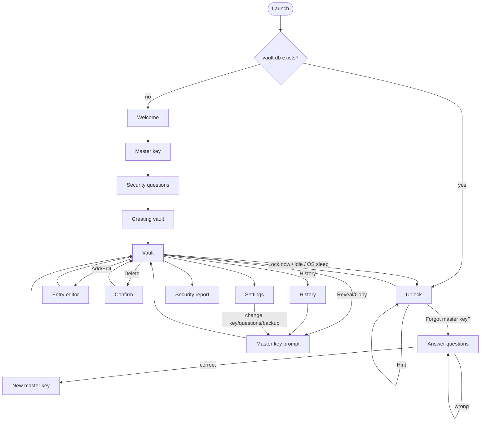

# VaultLocal — Design (Phase 1)

> Status: **APPROVED 2026-11-05** with every recommendation in §12 accepted (see §12.1).

VaultLocal is an offline, single-user desktop password manager. Everything stays on the
machine: one encrypted SQLite file in the OS user-data directory, no network code at all.

---

## 1. Goals and non-goals

**Goals**
- Store account credentials encrypted at rest with a key hierarchy that supports two
  unlock paths: the master key, and recovery via security questions.
- Make shoulder surfing and casual guessing hard: masked passwords, a master key prompt for
  every reveal or copy, auto re-mask, and persistent progressive lockout.
- Run with no network access at all, and prove it (Phase 3).

**Non-goals**
- Sync, browser autofill, multiple users, sharing, mobile.
- Protection against malware running as the same OS user while the vault is unlocked (§5).

---

## 2. Module and package structure (hexagonal)

Gradle Kotlin DSL, multi-module. Dependencies point inward only: adapters depend on
`application`, `application` depends on `domain`, and `domain` depends on nothing.
ArchUnit tests enforce this.

```
vaultlocal/
├── settings.gradle.kts
├── build.gradle.kts                 shared config (Java 21 toolchain, JUnit 5, AssertJ)
├── gradle/libs.versions.toml        version catalog, all versions pinned
├── domain/                          pure Java, no third-party dependencies
├── application/                     use cases + ports
├── adapters/
│   ├── crypto/                      Bouncy Castle Argon2id + JCA AES-GCM + SecureRandom
│   ├── persistence-sqlite/          sqlite-jdbc repositories + schema migrations
│   └── ui-javafx/                   JavaFX views, view-models, custom SecretField control
├── app/                             composition root (main), jlink/jpackage config
└── docs/
```

Base package: `com.codewitheli.vaultlocal`.

### 2.1 `domain` — `com.codewitheli.vaultlocal.domain`

| Package | Contents |
|---|---|
| `secret` | `Secret`: an `AutoCloseable` holder for `char[]`. It has `close()` (zeroes the array), `length()` in code points, `toString()` → `"Secret[***]"`, and no `equals`/`hashCode`. `SecretBytes` is the same for `byte[]`. |
| `entry` | `EntryId` (UUID), `Platform` (sealed: built-in enum value or `Custom(name)`), `Entry` (decrypted view used while unlocked), `EncryptedEntry` (what persistence sees), `PasswordHistoryItem`. |
| `recovery` | `SecurityQuestion` (predefined id or custom text), `AnswerNormalizer` (works on `char[]`, never builds a `String`). |
| `policy` | `MasterKeyPolicy` (min 12 code points), `LockoutPolicy` (delay = min(2^(n-1), 60) s), `StalenessPolicy` (default 90 days), `AutoLockPolicy`. |
| `audit` | `ActivityEvent` + `ActivityType` enum. No secret-carrying fields exist on these types. |
| `error` | Domain exceptions with **fixed** messages. User input is never put into a message. |

### 2.2 `application` — `com.codewitheli.vaultlocal.application`

**Inbound ports (`port.in`)** are one interface per use case:

`SetupVaultUseCase`, `UnlockVaultUseCase`, `LockVaultUseCase`, `VerifyMasterKeyUseCase`
(behind reveal and copy), `RevealPasswordUseCase`, `CopyPasswordUseCase`, `RecoverVaultUseCase`,
`ManageEntriesUseCase` (add/edit/delete/list), `MasterKeyHintUseCase`, `ChangeMasterKeyUseCase`,
`ChangeSecurityQuestionsUseCase`, `GeneratePasswordUseCase`, `SecurityReportUseCase`,
`BackupUseCase`, `ActivityLogQuery`, `SettingsUseCase`.

**Outbound ports (`port.out`)**:

| Port | Responsibility | Adapter |
|---|---|---|
| `KeyDerivationPort` | `deriveKey(SecretBytes input, KdfParams, salt) → SecretBytes(32)` | crypto (BC Argon2id) |
| `AeadPort` | `seal(key, plaintext, aad) → Sealed`, `open(key, Sealed, aad)` | crypto (JCA AES-256-GCM) |
| `RandomPort` | salts, nonces, DEK, generated passwords and master keys | crypto (`SecureRandom`) |
| `VaultMetaRepository` | vault id, format version, master key length | sqlite |
| `KeyWrapRepository` | MASTER / RECOVERY wraps (replaced atomically) | sqlite |
| `SecurityQuestionRepository` | the 3 chosen questions (not the answers) | sqlite |
| `EntryRepository` / `PasswordHistoryRepository` | encrypted rows only | sqlite |
| `LockoutRepository` | failure counters and lock-until timestamps per channel | sqlite |
| `ActivityLogRepository`, `SettingsRepository` | non-secret data | sqlite |
| `UnitOfWork` | runs a block in one SQLite transaction | sqlite |
| `ClockPort` | wall clock plus a monotonic clock (injectable for tests) | app |
| `ClipboardPort` | put, clear-if-still-ours | ui-javafx |
| `BackupFilePort` | read/write `.vlbackup` bytes | app (java.nio) |

**Services (`service`)** implement the inbound ports. The important internal pieces:

- `KeyHierarchy`: creates, wraps, unwraps, and rotates the DEK. This is the only class that
  touches KEKs.
- `EntryCipher`: turns `Entry` into `EncryptedEntry` and back, one AEAD call per field, with
  per-field AAD (§4.4). Encryption happens here, in the application layer, so the
  **persistence adapter never sees plaintext**.
- `VaultSession`: holds the unwrapped DEK while the vault is unlocked. `lock()` zeroes it and
  publishes a `VaultLocked` event that the UI uses to wipe its models.

### 2.3 Adapters

- **crypto**: `Argon2idKdf` (BC `Argon2BytesGenerator`), `AesGcmAead` (JCA
  `AES/GCM/NoPadding`), `SecureRandomSource` (`SecureRandom.getInstanceStrong()` only for the
  DEK and salts, `new SecureRandom()` for everything else, so a blocking entropy source can't
  stall the UI). Bouncy Castle is used as a **library** (`bcprov` lightweight API). It is not
  registered as a JCA provider; AES comes from the JDK's SunJCE.
- **persistence-sqlite**: JDBC repositories plus a ~50-line migration runner (versioned SQL
  files in resources, tracked with `PRAGMA user_version`). **Flyway is deliberately not used**:
  recent Flyway versions include Redgate telemetry, and a disabled-by-config network path is
  still a network path.
- **ui-javafx**: FXML-free views built in code (easier to test with TestFX), one view-model per
  screen, CSS themes, the `SecretField` control (§6.3), and the platform badge renderer.
- **app**: `Main` wires everything, sets up the data directory and logging, takes the
  single-instance lock, and starts JavaFX.

### 2.4 Third-party dependencies (complete list)

| Library | Why | Network surface |
|---|---|---|
| OpenJFX 21 (`controls`, `graphics`, `base`) | UI | none. **`javafx.web` (WebView) and `javafx.media` are excluded.** |
| `org.xerial:sqlite-jdbc` | storage | none. It extracts its native `.dll` to a temp dir at startup; we point `org.sqlite.tmpdir` at the app data dir. |
| `org.bouncycastle:bcprov-jdk18on` | Argon2id | none |
| ~~`com.nulab-inc:zxcvbn` (zxcvbn4j)~~ | strength meter | **Rejected (Q8).** Its `DictionaryMatcher` builds `String`s from the password. Replaced by an in-house `char[]` estimator (§13). |
| `net.java.dev.jna:jna-platform` | Windows session-lock hook (Q10), dark-mode detection, clipboard spike | none (local Win32 calls only) |
| Test only: JUnit 5, AssertJ, TestFX + Monocle (headless), ArchUnit | — | not shipped |

No logging framework: we use `java.lang.System.Logger`, which goes to JUL with a file handler
only. Build-time Gradle downloads from Maven Central are expected. The "no network"
constraint applies to the **shipped application**.

---

## 3. Storage

### 3.1 Location

| OS | Directory |
|---|---|
| Windows | `%LOCALAPPDATA%\VaultLocal\` (Local, **not** Roaming: roaming profiles can sync over a domain network) |
| macOS | `~/Library/Application Support/VaultLocal/` |
| Linux | `$XDG_DATA_HOME/vaultlocal/` (fallback `~/.local/share/vaultlocal/`) |

Contents: `vault.db`, `vault.lock` (single-instance file lock), `logs/`, `native/` (sqlite-jdbc
temp extraction). On POSIX systems the directory is created with `0700` permissions; on
Windows the user profile ACL applies.

### 3.2 SQLite settings

```
PRAGMA journal_mode = DELETE;   -- no -wal/-shm side files lingering next to the DB
PRAGMA secure_delete = ON;      -- freed pages are zero-filled (matters for replaced key wraps)
PRAGMA temp_store = MEMORY;     -- no temp files for sorts
PRAGMA foreign_keys = ON;
```

### 3.3 Schema

Legend: 🔒 = AES-256-GCM ciphertext blob (format in §4.4). Everything else is plaintext, and
each plaintext column is listed with what it reveals.

```sql
-- Singleton row describing the vault.
CREATE TABLE vault_meta (
  id                 INTEGER PRIMARY KEY CHECK (id = 1),
  vault_id           TEXT    NOT NULL,       -- random UUID, used in AAD
  format_version     INTEGER NOT NULL,       -- 1
  master_key_length  INTEGER NOT NULL,       -- code points; required for the Hint
  dek_generation     INTEGER NOT NULL,       -- increments on DEK rotation, used in AAD
  created_at         INTEGER NOT NULL        -- epoch millis UTC
);

-- Exactly two rows: 'MASTER' and 'RECOVERY'.
CREATE TABLE key_wrap (
  wrap_type          TEXT    PRIMARY KEY CHECK (wrap_type IN ('MASTER','RECOVERY')),
  kdf_algorithm      TEXT    NOT NULL,       -- 'argon2id'
  kdf_version        INTEGER NOT NULL,       -- 19 (0x13)
  kdf_memory_kib     INTEGER NOT NULL,
  kdf_iterations     INTEGER NOT NULL,
  kdf_parallelism    INTEGER NOT NULL,
  salt               BLOB    NOT NULL,       -- 16 random bytes
  wrapped_dek        BLOB    NOT NULL,       -- 🔒 DEK sealed under the KEK (nonce inside the blob)
  updated_at         INTEGER NOT NULL
);

-- The 3 chosen questions. Answers are NEVER stored, in any form.
CREATE TABLE security_question (
  slot               INTEGER PRIMARY KEY CHECK (slot IN (1,2,3)),
  question_key       TEXT    NOT NULL,       -- e.g. 'FIRST_PET', or 'CUSTOM'
  custom_text        TEXT                    -- plaintext: it must be shown before unlock
);

CREATE TABLE entry (
  id                  TEXT    PRIMARY KEY,   -- random UUID, used in AAD
  platform            BLOB    NOT NULL,      -- 🔒 built-in code or custom name
  account_label       BLOB    NOT NULL,      -- 🔒
  username            BLOB    NOT NULL,      -- 🔒
  password            BLOB    NOT NULL,      -- 🔒
  website_url         BLOB,                  -- 🔒 optional
  notes               BLOB,                  -- 🔒 optional
  favorite            INTEGER NOT NULL DEFAULT 0,
  created_at          INTEGER NOT NULL,
  updated_at          INTEGER NOT NULL,
  password_changed_at INTEGER NOT NULL       -- drives the stale badge (Q6)
);

CREATE TABLE password_history (
  entry_id           TEXT    NOT NULL REFERENCES entry(id) ON DELETE CASCADE,
  seq                INTEGER NOT NULL,       -- 1 = most recent previous password
  password           BLOB    NOT NULL,       -- 🔒
  replaced_at        INTEGER NOT NULL,
  PRIMARY KEY (entry_id, seq)                -- service keeps seq 1..5 only
);

CREATE TABLE lockout_state (
  channel              TEXT    PRIMARY KEY CHECK (channel IN ('MASTER','RECOVERY')),
  consecutive_failures INTEGER NOT NULL DEFAULT 0,
  last_failure_at      INTEGER,
  locked_until         INTEGER             -- epoch millis; NULL = not locked
);

CREATE TABLE activity_log (
  id                 INTEGER PRIMARY KEY AUTOINCREMENT,
  occurred_at        INTEGER NOT NULL,
  event_type         TEXT    NOT NULL,       -- UNLOCK_OK, UNLOCK_FAILED, REVEAL, COPY, ...
  entry_id           TEXT                    -- opaque UUID only; resolved to a label in the UI after unlock
);

CREATE TABLE settings (
  key                TEXT PRIMARY KEY,       -- auto_lock_minutes, stale_days, theme, ...
  value              TEXT NOT NULL
);
```

**What the plaintext reveals to someone holding the file:** the number of entries, their
timestamps, favorite flags, the question choices (and custom question text), the master key
length, the lockout counters, and the activity log (event types and times, no secrets).
Labels, platforms, usernames, URLs, notes, and passwords are all encrypted.

**Why everything user-entered is encrypted, platform and label included:** the platform list
alone ("Bank: BPI", "Gmail: work") is valuable to an attacker and to a nosy finder of a stolen
laptop. Sorting and filtering happen in memory after unlock, so encrypting these fields costs
nothing.

---

## 4. Key hierarchy and cryptography

### 4.1 Diagram

```
  Master key (char[])                          3 normalized answers (char[] each)
        │ UTF-8 → byte[]                              │ length-prefixed concat → byte[]
        ▼                                             ▼
  Argon2id(salt_M, m=128 MiB, t=3, p=4)        Argon2id(salt_R, m=256 MiB, t=6, p=4)
        │                                             │
        ▼                                             ▼
     KEK_M (256-bit)                               KEK_R (256-bit)
        │                                             │
        │  AES-256-GCM wrap                           │  AES-256-GCM wrap
        │  AAD = "VL1|wrap|MASTER|vaultId|gen"        │  AAD = "VL1|wrap|RECOVERY|vaultId|gen"
        ▼                                             ▼
  key_wrap['MASTER'].wrapped_dek             key_wrap['RECOVERY'].wrapped_dek
        └────────────────┬────────────────────────────┘
                         ▼   (either one unwraps the same key)
                 DEK (random 256-bit, SecureRandom)
                         │  AES-256-GCM, fresh 96-bit nonce per field
                         │  AAD = "VL1|entry|<entryId>|<fieldName>|gen"
                         ▼
          entry.* 🔒 fields, password_history.password 🔒
```

**Master key verification = successful unwrap.** There is no stored verifier or hash. A wrong
key produces a GCM tag failure, which we report as "wrong master key". This holds for unlock
and for every reveal/copy prompt: the prompt re-derives KEK_M and checks that it unwraps the
MASTER wrap.

### 4.2 Parameters and justification

| Item | Value | Justification |
|---|---|---|
| DEK | 256-bit from `SecureRandom.getInstanceStrong()` | AES-256 key size |
| Field cipher | AES-256-GCM, 96-bit random nonce, 128-bit tag | NIST SP 800-38D. JCA standard, AEAD, hardware-accelerated (AES-NI) |
| Wrap cipher | AES-256-GCM, same format | One primitive throughout. Every wrap uses a fresh salt, so a fresh KEK, so nonce reuse under a KEK cannot happen. (JCA `AES/KW` would also work; GCM keeps one code path.) |
| KDF | Argon2id v1.3 (RFC 9106) via Bouncy Castle | Memory-hard, the RFC's recommended variant, resists GPU/ASIC attacks and side channels |
| Salt | 16 random bytes per wrap, new on every rewrap | RFC 9106 recommends 128-bit salts |
| KDF output | 32 bytes | AES-256 KEK |
| **Master KDF** | **m = 131,072 KiB (128 MiB), t = 3, p = 4** | RFC 9106 §4's "second recommended option" (64 MiB, t=3, p=4), scaled to 2× memory because this is a desktop app. Target is **≤ 1.5 s** on a mid-range laptop, since the user pays this cost on **every reveal**. |
| **Recovery KDF** | **m = 262,144 KiB (256 MiB), t = 6, p = 4** | About 4× the master cost (2× memory × 2× passes). Recovery is rare, so ~3–6 s is acceptable. This makes each guess more expensive, but see §5.3 for why it can't make up for low-entropy answers. |
| Recovery input encoding | For each answer i: `u32_be(len_i) ‖ utf8(norm(answer_i))` | Length prefixes prevent ambiguity: `"ab"+"c"` ≠ `"a"+"bc"`. |

**Calibration:** the first step of Phase 2 includes a benchmark. If BC's pure-Java Argon2id
exceeds the time budget on this machine, I lower `t` first (2 for master) and keep memory
fixed, since memory is what hurts GPU attackers. KDF params are stored **per wrap**, so they
can be raised later and applied transparently on the next successful unlock.

**JVM heap:** BC allocates Argon2 memory on the Java heap, so the launcher sets `-Xmx768m`
(256 MiB recovery + headroom).

**GCM nonce budget:** NIST caps random-nonce GCM at 2³² encryptions per key. A vault encrypts
~6 fields per save; even 1 million saves is ~2²³. We track nothing extra, but DEK rotation
(§4.5) resets the budget anyway.

### 4.3 Secret handling in memory

- Master key, answers, DEK, KEKs, and entry passwords live in `Secret`/`SecretBytes`
  (`char[]`/`byte[]`) and are used in try-with-resources so `close()` zeroes them.
- `char[] → byte[]` goes through `CharsetEncoder` into a buffer we own and zero afterwards.
  `new String(chars)` is never used.
- **Known JVM limits, documented rather than hidden:** the GC can move and copy arrays before
  we zero them; `SecretKeySpec` and the AES key schedule inside `Cipher` hold copies we can't
  wipe (they become unreachable right after each operation); and the OS can page process
  memory to the pagefile or hibernation file. The mitigation for the last one is OS full-disk
  encryption (BitLocker / FileVault / LUKS), which the user guide will recommend.
- **Where a `String` is unavoidable:** (a) the text node that displays a revealed password for
  15 s; (b) the OS clipboard for copy; (c) JavaFX key events deliver typed characters as
  1-char strings. §6.3 explains how `SecretField` keeps the whole secret from ever existing
  as one `String`.
- Hardening flags in the launcher: `-XX:+DisableAttachMechanism` (blocks `jcmd`/`jmap` heap
  dumps from other same-user processes), no `HeapDumpOnOutOfMemoryError`,
  `-XX:-CreateCoredumpOnCrash` (no Windows minidump), and `-XX:+SuppressFatalErrorMessage` (no
  `hs_err` file). *Changed in Phase 2 from "`-XX:ErrorFile` in the log dir"; see §13.*

### 4.4 Ciphertext blob format

```
byte 0       format version (0x01)
bytes 1–12   GCM nonce (random)
bytes 13–    ciphertext ‖ 16-byte tag
```

The AAD binds each blob to its vault, row, field, and DEK generation. That way an attacker who
can edit the file cannot swap a password into another entry or another field without the
decryption failing. Limitation: AAD does not stop **whole-file rollback** or deleting a whole
row. Integrity of the row set is out of scope for v1.

### 4.5 Flows at the key level

| Flow | What happens (all DB writes in one transaction) |
|---|---|
| **Setup** | Generate DEK and two salts → derive KEK_M and KEK_R → write both wraps, the questions, and `master_key_length` → zero everything except the DEK, which goes into `VaultSession`. |
| **Unlock / verify** | Check lockout → derive KEK_M → unwrap. Success resets the MASTER counter. Failure increments it, sets `locked_until`, and logs `UNLOCK_FAILED`. |
| **Recovery** | Check RECOVERY lockout → derive KEK_R → unwrap DEK → user sets a new master key → **replace** the MASTER row (new salt, new wrap) and update `master_key_length`. See Q1 for whether the DEK is also rotated. |
| **Change master key** | Verify the current key → new salt and KEK_M → replace the MASTER row. |
| **Change questions** | Verify the master key → collect new questions and answers → new salt and KEK_R → replace the RECOVERY row and the questions. |

"Replace" means an `UPDATE` of the single row. With `secure_delete=ON`, SQLite zero-fills the
old page content, and a `VACUUM` afterwards rebuilds the file. Phase 3 checks that the old
`wrapped_dek` bytes no longer appear anywhere in `vault.db`. The rollback journal is deleted on
commit; on an SSD, freed blocks cannot be reliably wiped by any application. That is why Q1
recommends DEK rotation, which makes any surviving old wrap **cryptographically** useless.

---

## 5. Threat model

### 5.1 Protects against

| Threat | Mitigation |
|---|---|
| **Stolen laptop or copied `vault.db`** (offline attacker) | Everything user-entered is AES-256-GCM encrypted. Each guess against either wrap costs a full Argon2id evaluation (128 MiB or 256 MiB). There is no verifier hash to attack more cheaply. |
| **Shoulder surfing** | Fixed-width masks (length hidden); every reveal needs the master key; auto re-mask after 15 s; masked input fields; the Hint shows only the length. |
| **Someone at an unlocked, unattended machine** | Reveal and copy still need the master key; auto-lock after idle and on OS sleep/lock (optional feature); clipboard auto-clear. |
| **Online guessing at the UI** | Progressive delay (1, 2, 4, … 60 s) per channel, persisted across restarts, plus ~1 s of Argon2 per attempt. |
| **Tampering that swaps ciphertexts** | AAD binding (§4.4). |
| **Leaks via logs, exceptions, or crash output** | No secret type has a meaningful `toString`; exception messages are fixed strings; logging goes through one wrapper; tests scan log output for canary secrets. |
| **Accidental network exfiltration** | No network code, no network-capable dependencies, and `javafx.web` / `java.net.http` are excluded from the jlink runtime. Verified in Phase 3. |

### 5.2 Does NOT protect against

- **Malware, a keylogger, or a screen recorder running as the user.** It sees the master key
  as it's typed and can read process memory while the vault is unlocked.
- **An attacker with OS admin or root access**, a debugger, or a cold-boot / DMA memory attack.
- **Pagefile or hibernation-file remnants** of process memory (mitigation: full-disk encryption).
- **Clipboard managers and Windows Clipboard History / cloud clipboard** capturing a copied
  password before the 20 s clear (partial mitigation: Q9).
- **Bypassing the lockout delay offline.** The counter lives in the same file, so an attacker
  with the file just runs Argon2 directly. **The delay only stops UI guessing. Argon2 plus a
  strong master key is the real offline defense.**
- **Whole-file rollback, deleting the file, or ransomware.** Backups (optional feature) are
  the mitigation.
- **A weak master key or guessable answers.** See below.

### 5.3 Security questions are weaker than the master key, and why

The vault opens with **either** the master key **or** the three answers. So against an offline
attacker, the vault is only as strong as the **weaker** of the two:

1. **Low entropy.** Answers like a pet's name, a city, or a school come from small, guessable
   sets. Three typical answers combined give maybe 20–40 bits, compared with ~140 bits for a
   generated master key.
2. **Normalization shrinks the space further.** Removing case and collapsing whitespace makes
   answers easier to remember and also easier to guess.
3. **Answers can be researched.** Social media, data breaches, and people who know the user
   can supply them. Nobody can research a random master key.
4. **A heavier KDF only adds a constant.** 4× the Argon2 cost adds about 2 bits. It can't turn
   a 30-bit answer set into a 128-bit secret.

Mitigations: the setup screen states this plainly and recommends custom questions with
non-factual answers ("treat them like passwords"); each answer must be at least 3 characters
after normalization; the recovery wrap gets the heavier KDF; and recovery has its own
persistent lockout. The real fix, offering to disable recovery entirely, is a spec change I
raise in Q4.

### 5.4 The Hint leaks the length, by design

`master_key_length` is stored in plaintext because the hint has to work before unlock. For
brute force this costs well under a bit, since a search space is dominated by its longest
length anyway. It helps dictionary attacks more, by letting an attacker filter candidates by
length. With a generated 24-character key the leak is irrelevant. The setup screen mentions it.

---

## 6. Feature behavior details

### 6.1 First-run setup
- **Typed key:** at least 12 code points, entered twice. A zxcvbn strength meter shows
  0–4 with a label and feedback. Whether a weak key can still be accepted is Q3.
- **Generated key:** 24 characters from a 56-character alphanumeric alphabet with no ambiguous
  characters (`0 O o 1 l I`), about 139 bits. It is shown once, in a monospace grouped display, with
  Copy (clipboard auto-clears after 20 s) and an "I've saved it" checkbox that gates Next.
  After that it's gone from memory.
- **Questions:** three dropdowns of distinct questions, from the predefined list (below) or
  "Write my own…". Each answer is typed twice in masked fields with a show toggle.
  **Normalization rules shown on screen:** *"Spaces at the start and end are ignored. Several
  spaces in a row count as one. Upper/lower case doesn't matter. Everything else, including
  punctuation and accents, must match exactly."*
- Normalization implementation: trim Unicode whitespace → collapse runs of whitespace into one
  U+0020 → `Character.toLowerCase(codePoint)` (locale-independent, which avoids the Turkish-İ
  problem). Unicode NFC normalization is **not** applied because `java.text.Normalizer` only
  returns `String`. I'll document this edge case: the same accented letter typed two
  different ways won't match.
- Predefined questions (chosen to be less researchable than "mother's maiden name"):
  1. What was the name of your first pet?
  2. What was the first concert you attended?
  3. What was the make and model of your first car?
  4. In what city did your parents meet?
  5. What was your childhood best friend's nickname?
  6. What was the name of the street you lived on in third grade?
  7. What was the first dish you learned to cook?
  8. What was the name of your favorite teacher in primary school?
  9. What is the title of the first book you remember loving?
  10. Write my own…

### 6.2 Entries and list
- Fields per spec. Required: platform, account label, username/email, password. Optional: URL
  and notes. URLs are syntax-checked only and **never fetched** (no favicons).
- Platforms: Facebook, TikTok, Gmail, Instagram, X, Bank, Other, plus custom names. **Badge =
  colored rounded square with a letter or monogram** (e.g. blue "f", black "X"). Bank and
  Other get generic glyphs drawn as JavaFX `SVGPath`. No trademark logos are bundled, so the
  public repo has no licensing problems (Q7).
- Table columns: Platform | Account label | Username | Password (`••••••••`, always 8 bullets) |
  Last updated | Actions (Reveal, Copy*, Edit, Delete). All columns sortable except Password and
  Actions. Delete opens a confirmation dialog that names the entry's label.

### 6.3 `SecretField`, the custom input control
JavaFX's `PasswordField` keeps its content in an internal `StringBuilder`, and its skin
creates full `String` copies of the password. VaultLocal adds a small custom control for
**master key and answer input**:
- It keeps its contents in a growable `char[]` and zeroes the old buffer when resizing. It
  renders bullets. With the show toggle on it renders the plaintext, and like a revealed
  password, that text exists as a `String` in the text node only while it's visible.
- Editing support: type, Backspace, Delete, caret left/right/home/end, select all, paste.
  Paste necessarily passes through a `String` from the OS clipboard.
- `takeSecret()` hands the `char[]` over and clears the field.

Entry-password fields in the editor use the same control. Ordinary text fields (label,
username, notes) are plain `TextField`s; these are encrypted at rest but held as `String`
while the vault is unlocked (§4.3).

### 6.4 Reveal, hint, and lockout
- The app always starts on the **Unlock** screen. The master key unlocks the vault, which
  decrypts the list. Passwords stay masked: the "locked-reveal" state (Q2).
- Reveal: master key prompt (with Hint) → verify (§4.1) → decrypt **that entry's** password →
  show it with a visible 15-second countdown ring → re-mask, wipe the text node, and zero the
  buffer. Re-masking happens **early** on window minimize, focus loss, or lock.
- Lockout per channel (MASTER, RECOVERY): after the n-th consecutive failure, the delay is
  `min(2^(n-1), 60)` seconds, so 1, 2, 4, 8, 16, 32, 60, 60, … `locked_until` is persisted.
  On startup, if the current time is before `locked_until`, the input shows a countdown and
  stays disabled. If the clock has moved backwards (now < `last_failure_at`), the full delay is
  re-applied from now, so changing the system clock doesn't help. The counter resets on
  success. Reveal and copy prompts share the MASTER counter with Unlock.
- Hint: shows exactly `Your master key has N characters.` Nothing else.

### 6.5 Forgot master key
Unlock → "Forgot master key?" → the 3 questions with answer fields → verify (RECOVERY lockout
applies; the user is never told *which* answer was wrong, and the code can't know) → the
Set-new-master-key screen (type or generate, same rules as setup) → MASTER wrap replaced → the
vault opens unlocked. The user cannot back out between unwrap and rewrap without the DEK being
discarded.

### 6.6 Optional features (design is ready; build depends on Q5)

| Feature | Design notes |
|---|---|
| Password generator | Length 8–128 (default 20); toggles for upper, lower, digits, symbols, exclude ambiguous. Uses `SecureRandom`, unbiased (rejection sampling), and guarantees at least one character from each selected class. Output goes straight into a `char[]`. |
| Strength indicator | zxcvbn score badge per entry. Computed in the background after unlock and kept **in memory only** (storing it would tell an attacker which entries are weak). |
| Copy to clipboard | Requires the master key. After 20 s the clipboard is cleared **only if it still holds our value** (checked against an in-memory SHA-256, never persisted). Also cleared on lock and on exit. |
| Auto-lock | Idle timer, default 5 min (1–60 configurable), reset by any key or mouse event. Also locks on OS sleep/lock, using `java.awt.Desktop` app events where the platform supports them plus a wall-vs-monotonic clock-jump detector that catches sleep everywhere. Windows session-lock detection is Q10. Lock zeroes the DEK, clears all view-models, closes dialogs, and clears the clipboard. |
| Search and filter | In-memory, case-insensitive, over platform, label, and username, plus a platform dropdown filter. |
| Favorites | Star toggle; favorites sort first and can be filtered. |
| Stale badge | Shown when `password_changed_at` is older than N days (default 90, configurable). |
| Security report | Weak (zxcvbn ≤ 1), reused (in-memory SHA-256 grouping, discarded afterwards), stale. Shows entry names only, never passwords. |
| Password history | When a password changes, the old one is re-encrypted with a fresh nonce and the history AAD and stored at seq 1, shifting the others; only 5 are kept. Revealing one needs the master key. Deleting an entry cascades to its history. |
| Encrypted backup | `.vlbackup` = `magic "VLBK" ‖ version ‖ KDF params ‖ salt ‖ nonce ‖ AES-GCM(payload)`, where the key is Argon2id(master key, fresh salt, master params). The payload is a length-prefixed binary encoding of every entry and its history, decrypted and re-encrypted (no JSON library, so no `String` copies), and contains no key material from the vault. Import asks for the master key that was active **when the backup was made**, then offers Merge (skip exact duplicates) or Replace (with confirmation). |
| Activity log | The events listed in the schema, with no secrets and only opaque entry IDs. Pruned to the last 1,000 events. Viewable in Settings. |
| Change master key / questions | §4.5 flows, in Settings, each re-verifying the master key first. |
| Light/dark theme | Two CSS files, defaulting to the OS setting where it can be detected (otherwise light), with a manual toggle. System font (Segoe UI on Windows). **No web fonts.** |

### 6.7 Logging and errors
- Log events: app start/stop, unlock success/failure (no input), migrations, I/O errors.
  Logs never contain entry contents (not even labels), input lengths, or key material.
- The uncaught-exception handler logs the exception class plus a sanitized message (our own
  exceptions only; third-party messages are dropped) and shows a generic dialog.
- Log files rotate at 1 MB × 3 in `logs/`.

---

## 7. Screens and navigation

| # | Screen | Purpose |
|---|---|---|
| S1 | Welcome | First run only. Explains what VaultLocal is and that nothing leaves the machine. |
| S2 | Setup: Master key | Type (×2 + meter) or Generate (shown once, Copy, "I've saved it"). Notes the hint leak. |
| S3 | Setup: Security questions | 3 questions + answers (×2), normalization rules, the weaker-than-master warning. |
| S4 | Setup: Creating vault | Progress while both Argon2 runs happen (~5 s). |
| S5 | Unlock | Master key, Unlock, Hint, "Forgot master key?", lockout countdown. |
| S6 | Recovery: Answer questions | 3 answers, RECOVERY lockout countdown. |
| S7 | Recovery: New master key | Same component as S2. |
| S8 | Vault (main) | Toolbar (Add, Search, Platform filter, Favorites, Report, Settings, Lock now), table, status bar (entry count, auto-lock timer). |
| D1 | Entry editor (dialog) | Add/Edit, generator, strength. |
| D2 | Delete confirmation | Names the entry. |
| D3 | Master key prompt | For reveal, copy, history, and sensitive settings. Has Hint and lockout. |
| D4 | Password history | List of 5 masked entries; each reveal goes through D3. |
| S9 | Security report | Weak / reused / stale groups. |
| S10 | Settings | Auto-lock, stale days, theme, change master key, change questions, export/import backup, activity log. |



---

## 8. Testing strategy

| Layer | Tests |
|---|---|
| domain | `AnswerNormalizer` (whitespace kinds, case, Turkish İ, no `String` creation verified by API shape), `LockoutPolicy` sequence and cap, `MasterKeyPolicy` code-point counting (emoji = 1). |
| crypto | Argon2id against **RFC 9106 test vectors**; AES-GCM round trip, tag-tamper → failure, AAD mismatch → failure; nonce uniqueness across 10⁵ seals. |
| key hierarchy | setup → unlock ✓ → wrong key ✗ → recover ✓ → **old key ✗** → new key ✓; change questions → old answers ✗; production KDF constants pinned by a test. Fast test KDF params (m = 8 MiB) everywhere else. |
| persistence | temp-file DB: migrations, CRUD, atomic wrap replacement, lockout persistence across reopen. **Canary scan:** insert entries with unique canary strings and assert that no UTF-8 or UTF-16 form appears in the raw bytes of `vault.db` (or any journal). Assert the old `wrapped_dek` bytes are absent after recovery. |
| application | use cases against in-memory fakes plus a fake clock: lockout timings, 15 s re-mask, 20 s clipboard clear, auto-lock. |
| architecture | ArchUnit: layer rules; **no use of `java.net.*` socket/URL-connection classes or `java.net.http` anywhere**; `Secret` never passed to a logger. |
| UI (TestFX, headless Monocle) | Setup (typed + generated), unlock + hint, wrong key → countdown, reveal → auto re-mask (injected clock), forgot-master-key end to end, delete confirmation. |
| logs | Run flows with canary secrets, then assert the log directory contains none of them. |

---

## 9. Packaging

- **jlink + jpackage** via the `org.beryx.jlink` Gradle plugin (handles JavaFX jmods and the
  non-modular jars). The runtime image contains only the modules we need: no `java.net.http`,
  no `javafx.web`, no `jdk.httpserver`.
- **Windows (first):** `.msi` via `jpackage --type msi`. **JDK 21's jpackage requires WiX
  Toolset 3.x on the PATH, and it is not installed on this machine yet**, so I'll ask before
  installing it. Per-user install, Start-menu shortcut, `--win-dir-chooser`, upgrade UUID
  pinned so new versions upgrade in place.
- **macOS:** `--type dmg` (or `pkg`) on a Mac; signing and notarization need an Apple
  Developer ID (documented, not done).
- **Linux:** `--type deb` / `rpm` on the matching distro (needs `fakeroot` / `rpm-build`).
- jpackage cannot cross-compile, so each OS must be built on that OS (or in CI later).
- Launcher JVM options: `-Xmx768m -XX:+DisableAttachMechanism -Dorg.sqlite.tmpdir=<appdata>/native`.

---

## 10. Phase 3 verification plan (preview)

1. **Network:** dependency tree review (`gradle dependencies`); grep for `java.net`, `URL`,
   `HttpClient`, `Socket`; the ArchUnit rule; the jlink module list; and a runtime check:
   run the packaged app through setup, unlock, CRUD, reveal, and backup while watching
   `Get-NetTCPConnection` / `Get-NetUDPEndpoint` filtered by the app's PID (expected: none).
2. **DB contents:** `sqlite3 vault.db .dump` plus a hex/strings scan for test canaries
   (`sqlite3` is available at `Android/Sdk/platform-tools/sqlite3`).
3. **Logs:** canary scan of `logs/`.
4. **Zeroing:** code review list of every `Secret` and `SecretBytes` lifecycle, plus unit tests
   asserting arrays are zero after `close()`.
5. **Lockout persistence:** fail 4×, kill the process, relaunch, and confirm the countdown
   resumes at the right remaining time.
6. **Recovery:** byte-search `vault.db` for the old `wrapped_dek` blob before and after
   recovery, and confirm the old master key fails.

---

## 11. Assumptions (decided unless you object)

1. **One vault per OS user**; a second app instance is refused via the `vault.lock` file lock.
2. **The app always opens on Unlock** (master key required), because labels and usernames are
   encrypted. "Locked-reveal" is the state *after* unlock: list visible, passwords masked.
3. **Each reveal or copy re-prompts for the master key** and applies to a single entry. There
   is no "reveal session" covering multiple entries.
4. Master key length and the minimum of 12 are counted in **Unicode code points**.
5. **The master key is not normalized**; it must match exactly.
6. Username/email is **required**; URL and notes are optional.
7. All 3 answers are needed together; the user is never told which one was wrong.
8. Each answer has a **minimum of 3 characters** after normalization and is confirmed by typing
   it twice.
9. Questions must be 3 distinct choices. Custom question text is stored **in plaintext**
   (shown before unlock), and the UI warns not to put secrets in it.
10. The master and recovery lockouts are **separate counters**. Reveal and copy share the
    master counter.
11. "Last updated" in the table is `updated_at`; the stale badge uses `password_changed_at` (Q6).
12. The website URL is never opened by the app; there is a "Copy URL" action instead of "Open".
13. Lockout times are stored as wall-clock epoch millis, with the clock-rollback rule from §6.4.
14. The 100% local constraint applies to the **shipped app**. Gradle and Maven Central are used
    at build time.
15. The project lives at `personal-projects/vaultlocal` (its own git repo; intended GitHub repo
    `dev-codewitheli/vaultlocal`). Once it's finished, a project card goes on the portfolio
    site, as you asked.

---

## 12. Open questions — need your decision

| # | Question | My recommendation |
|---|---|---|
| **Q1** | On recovery, the spec says "rewrap the DEK". Should recovery also **rotate the DEK**, meaning a new DEK, all entries re-encrypted, and both wraps rewritten? (Both secrets are in hand at that moment.) | **Yes, rotate.** A rewrap alone leaves the old DEK valid, so any surviving copy of the old wrap (SSD remnant, old file copy) plus the old master key still decrypts the new data. Rotation makes the old wrap useless. It costs about 1 s extra. |
| **Q2** | Confirm the interpretation: the master key is required **at app launch** to see the list, and **again** for each reveal or copy. | Yes (Assumption 2). The alternative, a list visible without unlock, would need labels and usernames stored in plaintext. |
| **Q3** | Should a master key that is ≥ 12 characters but scores **very weak** (zxcvbn 0–1, e.g. `aaaaaaaaaaaa`) be **blocked**, or only warned about? | **Block scores < 2**, with a "Generate" suggestion. |
| **Q4** | Should users be able to **turn off security-question recovery** (no RECOVERY wrap at all) for maximum security? | Offer it as an **advanced opt-out** during setup, defaulting to on per spec, with a clear warning that a forgotten key then means permanent data loss. |
| **Q5** | The optional-features checkboxes in your brief are all **unchecked**. Which ones are approved? | Everything except Windows session-lock detection is designed and cheap. If you want a lean v1: generator, strength, copy, auto-lock, search, stale badge, change key/questions, theme. Then v1.1: history, backup, report, favorites, activity log. |
| **Q6** | Should the stale badge use **password last changed**, rather than "Last updated" (which also changes when notes are edited)? | **Password last changed.** That's what "stale password" means. |
| **Q7** | Platform badges: are **colored letter/monogram badges** OK instead of real brand logos? | Yes. It avoids bundling trademarked logo files in a public repo. |
| **Q8** | Strength meter: **zxcvbn4j** (much better estimates; I'll confirm in Phase 2 that its `CharSequence` API doesn't materialize the password as a `String`), or a simpler in-house estimator working purely on `char[]`? | zxcvbn4j **if** that check passes; otherwise in-house. |
| **Q9** | Windows Clipboard History / cloud clipboard can retain copied passwords. Can I spike marking clipboard content as **excluded from history** (Windows' `ExcludeClipboardContentFromMonitorProcessing` format via a JavaFX custom `DataFormat`)? If JavaFX can't do it, I'll document the risk rather than add native code. | Yes, a time-boxed spike. |
| **Q10** | Auto-lock on **Windows session lock** (Win+L) needs a native hook (JNA + `WTSRegisterSessionNotification`). JNA is widely used and local-only, but it's one more dependency. Add it, or rely on idle timer + sleep detection only? | Add JNA for Windows session lock, since it's a real gap for "walked away from the desk". |
| **Q11** | Installing **WiX Toolset 3.14** on this machine is required for the `.msi`. OK to install it when we reach packaging? | Yes, at packaging time, with your go-ahead then. |

### 12.1 Decisions (approved 2026-11-05)

| # | Decision |
|---|---|
| Q1 | Recovery **rotates the DEK**: everything is re-encrypted under a new DEK, a new MASTER wrap is written, and the RECOVERY wrap is resealed. `dek_generation` increments. |
| Q2 | The master key is required at launch, and again for every reveal or copy. |
| Q3 | Master keys scoring zxcvbn < 2 are **blocked**, even when they are ≥ 12 characters. |
| Q4 | Recovery is on by default, with an **advanced opt-out** at setup. It can be turned back on later from Settings via Change security questions. |
| Q5 | **All listed optional features are approved.** Build order: generator, strength, copy, auto-lock, search, stale badge, change key/questions, theme; then history, backup, report, favorites, activity log. |
| Q6 | The stale badge uses `password_changed_at`. |
| Q7 | Colored letter/monogram badges; no brand logos. |
| Q8 | zxcvbn4j if its `CharSequence` path doesn't build a `String`; otherwise an in-house estimator. |
| Q9 | Time-boxed spike on excluding copied passwords from Windows Clipboard History. |
| Q10 | JNA is added for Windows session-lock detection. |
| Q11 | WiX 3.14 gets installed at packaging time, after a separate go-ahead. |

---

## 13. Implementation notes (Phase 2)

Outcomes of the open items, and the places where the build refines or departs from the text above.

**Needs your confirmation (a departure from what was agreed)**
- **Crash output (§4.3).** I replaced "`-XX:ErrorFile` pointed at the log dir" with
  `-XX:-CreateCoredumpOnCrash -XX:+SuppressFatalErrorMessage`. An `hs_err` file includes memory
  near the crashing registers, and a Windows minidump includes process memory; either could
  hold key material. The trade-off is that a JVM crash leaves no diagnostics. Say if you'd
  rather keep the `hs_err` file.

**Outcomes of the decisions**
- **Q8:** zxcvbn4j was rejected (it builds `String`s; see §2.4). `LocalStrengthEstimator` (in
  `app`) scores on `char[]` only. Entropy comes from the character pool and length, with
  discounts for repeats, sequences (abc/321), keyboard runs (qwe/asd) and a bundled list of
  about 340 common words and passwords, l33t-folded. Thresholds in bits are 28/40/60/80 for
  scores 1–4. Examples: `password1234` scores 0, 12 random lowercase letters score 2, a
  generated key scores 4.
- **Q9:** the spike **passed**. A JavaFX copy carries `ExcludeClipboardContentFromMonitorProcessing`,
  `CanIncludeInClipboardHistory = 0` and `CanUploadToCloudClipboard = 0`, verified through Win32
  on the real clipboard (`./gradlew :adapters:ui-javafx:windowsClipboardSpike`).
- **Q10:** `WindowsSessionLockSource` uses JNA to catch Win+L. `java.awt.Desktop` handles
  sleep, screen sleep and session events where supported (macOS). The clock-gap detector
  (> 30 s between 2 s ticks) catches sleep everywhere.
- **Benchmark (this machine, BC 1.79):** the master KDF takes 0.35–0.44 s and the recovery KDF
  1.4–2.7 s. The §4.2 parameters are unchanged.

**Refinements (no change to what was agreed)**
- **History AAD:** `VL1|history|<entryId>|<replacedAtMillis>|gen`. `seq` shifts when a new item
  is added, so binding to `replacedAt` avoids re-encrypting on every shift.
- **Ports:** the inbound ports keep the names from §2.2 and are grouped in `VaultUseCases`.
  Clipboard access lives in the UI adapter (`ClipboardService`) and backup file I/O in the
  Settings screen, so `ClipboardPort` and `BackupFilePort` weren't needed as application ports.
  Use cases take and return bytes and `Secret`s.
- **Runtime image:** jlink includes `java.base, java.desktop, java.sql, jdk.unsupported` (plus
  their dependencies). jdeps also listed `java.naming` (used only by Bouncy Castle's unused
  JCE CRL/LDAP code) and `jdk.jfr` (optional for JavaFX). Both are excluded, which removes
  JNDI/LDAP from the image.
- **Native libraries:** SQLite, JNA and JavaFX unpack into `<data dir>/native`, not `%TEMP%`
  or `~/.openjfx`.
- **Editing a password:** the editor leaves the field empty ("leave empty to keep the current
  password"), so editing never reveals the current password without the master key.
- **Copy username / Copy URL:** available from the row's right-click menu (assumption 12). These
  values aren't secret, so they aren't auto-cleared.
- **View-models:** the vault screen has `VaultViewModel` (filtering, favorites-first sorting,
  stale rule). The simpler form screens keep their small state inline.
